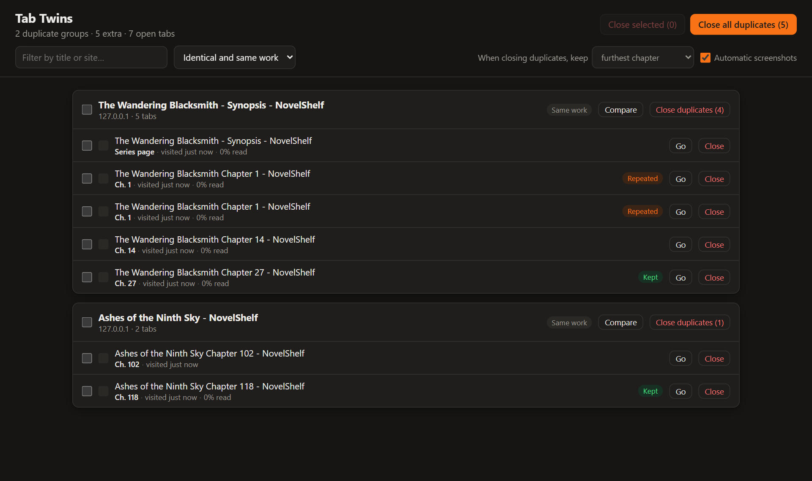
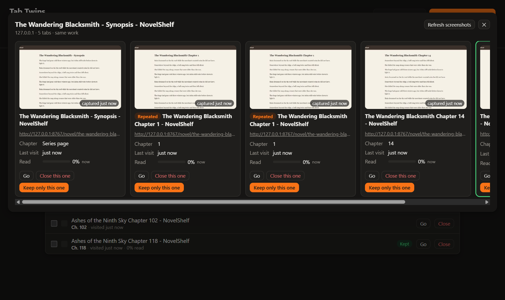
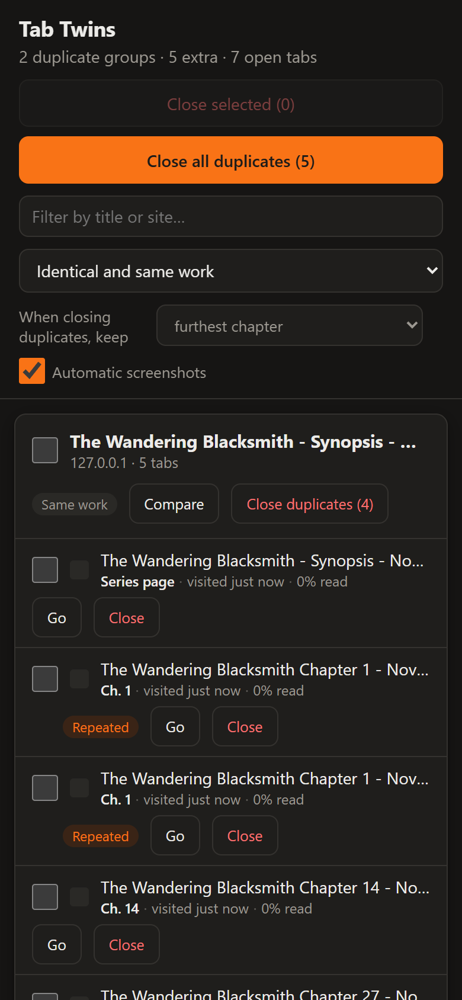

# Tab Twins

**Encuentra pestañas duplicadas, compáralas lado a lado y decide cuáles cerrar.**

Pensada para quien tiene decenas de pestañas abiertas, como quien lee novelas web: abre una novela, la deja para después, semanas más tarde la vuelve a encontrar y acaba con la misma historia abierta tres veces en capítulos distintos. Tab Twins detecta esas «gemelas», te enseña cuál va más avanzada y te deja cerrar el resto. Nunca cierra nada por su cuenta.

[English](README.md) · [Privacidad](PRIVACY.md#español) · [Cambios](CHANGELOG.md)



## Funciones

- **Detección inteligente**
  - **Idénticas:** la misma URL, sin contar `#fragmentos`, parámetros de rastreo (`utm_*`, `fbclid`…), `www.` ni `http`/`https`.
  - **Misma obra:** la misma novela o serie en la misma web aunque cambie el capítulo (`chapter-5`, `Ch. 12`, `Capítulo 3`, `第88章`…), incluida su ficha o sinopsis.
- **Buscador de todas las pestañas abiertas** en el popup del icono, con aviso si la pestaña actual tiene gemelas.
- **Comparación lado a lado:** captura, capítulo, última visita, cuánto llevas leído, ventana y grupo de pestañas.
- **Cierra justo lo que quieras:** una pestaña, las que selecciones, las duplicadas de un grupo o todas las duplicadas de lo filtrado. Filtros por ventana y por grupo de pestañas.
- **Elige cuál se conserva:** el capítulo más avanzado, la visitada más recientemente o la que abriste primero. Las fijadas nunca se cierran en bloque.
- **Siempre reversible:** los cierres en bloque piden confirmación y cualquier cierre se puede deshacer.
- **Contador** en el icono con las pestañas que sobran.
- **En español e inglés**, según el idioma del navegador.
- **Funciona en Firefox para Android**, con una interfaz pensada para el dedo.

| Comparar | Firefox para Android |
|---|---|
|  |  |

## Descargar e instalar

Descarga los archivos de la [última versión publicada](https://github.com/Aigen1111/tab-twins/releases/latest).

| Navegador | Archivo | Cómo instalarla |
|---|---|---|
| **Chrome, Brave, Edge, Opera, Vivaldi** (escritorio) | `tab-twins-<versión>-chromium.zip` | [Cargar descomprimida](#chrome-brave-edge-y-otros-navegadores-chromium) |
| **Firefox** (escritorio, 140 o superior) | `tab-twins-<versión>-firefox.zip` | [Complemento temporal](#firefox-escritorio) o desde Firefox Add-ons cuando esté publicada |
| **Firefox para Android** (142 o superior) | — | Desde Firefox Add-ons cuando esté publicada ([detalles](#firefox-para-android)) |
| Chrome y Brave para Android | — | No se puede: esos navegadores no admiten extensiones |

> Todavía no está en las tiendas (Chrome Web Store ni Firefox Add-ons). Mientras tanto, usa los archivos de la versión publicada.

### Chrome, Brave, Edge y otros navegadores Chromium

1. Descarga `tab-twins-<versión>-chromium.zip` y descomprímelo en una carpeta que vayas a conservar (el navegador la carga desde ahí).
2. Abre `chrome://extensions` (en Brave, `brave://extensions`; en Edge, `edge://extensions`).
3. Activa el **Modo de desarrollador**.
4. Pulsa **Cargar descomprimida** y elige la carpeta descomprimida (la que contiene `manifest.json`).
5. Fija el icono de Tab Twins en la barra.

Para actualizar, descomprime la versión nueva encima de la misma carpeta y pulsa el botón de recargar en la tarjeta de la extensión.

### Firefox (escritorio)

Firefox solo instala extensiones de forma permanente si Mozilla las ha firmado. Hasta que Tab Twins esté en Firefox Add-ons:

1. Descarga `tab-twins-<versión>-firefox.zip`.
2. Abre `about:debugging#/runtime/this-firefox`.
3. Pulsa **Cargar complemento temporal…** y elige el archivo zip.

Los complementos temporales se quitan al cerrar Firefox.

### Firefox para Android

Firefox para Android instala extensiones desde Firefox Add-ons. Cuando Tab Twins esté publicada allí, abre su página en el teléfono y pulsa **Añadir a Firefox**.

Si tienes un archivo `.xpi` **firmado**, también puedes instalarlo desde el archivo: **Ajustes › Acerca de Firefox**, pulsa cinco veces el logo de Firefox, vuelve a **Ajustes** y elige **Instalar extensión desde archivo**.

En Android no hay ventanas ni grupos de pestañas, así que esos filtros no aparecen. Todo lo demás funciona igual.

## Cómo se usa

1. Pulsa el icono de Tab Twins. Escribe para buscar entre todas tus pestañas o mira el resumen de duplicadas.
2. Pulsa **Revisar duplicados** para abrir el gestor.
3. Pulsa **Comparar** en un grupo para ver sus pestañas lado a lado. **Quedarme solo con esta** cierra el resto del grupo.
4. O usa **Cerrar duplicadas** en un grupo, o **Cerrar todas las duplicadas**. Se queda abierta la pestaña marcada con **Se conserva**, según la regla que elijas en **Al cerrar duplicadas, conservar**.
5. ¿Te arrepientes? Pulsa **Deshacer** en el aviso que aparece después de cerrar.

Las capturas se hacen cuando visitas una pestaña. Para las que no has visitado desde que instalaste la extensión, usa **Capturar** o **Actualizar capturas** en la comparación: activa cada pestaña un momento.

## Permisos y privacidad

Tab Twins no recoge, envía ni comparte nada. Todo se queda en tu navegador. Consulta la [política de privacidad](PRIVACY.md#español) completa.

| Permiso | Para qué |
|---|---|
| `tabs`, `tabGroups` | Leer el título, la URL y el grupo de tus pestañas abiertas para encontrar duplicadas |
| Acceso a todas las webs, `scripting` | Hacer capturas de las pestañas y saber cuánto has avanzado en la página |
| `storage`, `unlimitedStorage` | Guardar en local esas capturas pequeñas y la posición de lectura |

Las capturas y la posición de lectura se borran en cuanto no queda ninguna pestaña abierta con esa URL. Las capturas automáticas se pueden desactivar en el gestor.

## Limitaciones conocidas

- Los navegadores solo pueden capturar la pestaña **visible** de cada ventana, así que las pestañas que no has visitado desde que instalaste la extensión no tienen captura hasta que las capturas.
- No se sabe cuánto llevas leído en las pestañas que ya estaban abiertas y dormidas al instalar Tab Twins, hasta que las recargas.
- La detección de «misma obra» se basa en patrones de URL y de título. Las webs con URL poco habituales pueden no agruparse. [Abre una incidencia](https://github.com/Aigen1111/tab-twins/issues) con una URL de ejemplo.
- En Firefox, las pestañas con la misma URL en contenedores distintos cuentan como duplicadas.

## Desarrollo

Sin dependencias ni compilación: la carpeta del repositorio es la extensión. Los scripts necesitan Node.js 22.2 o superior.

```sh
npm test            # tests (detección, traducciones y empaquetado)
npm run locales     # regenera _locales/ a partir de scripts/locales.mjs
npm run package     # genera dist/tab-twins-<versión>-chromium.zip y -firefox.zip
```

Para probar cambios, carga la carpeta del repositorio como extensión descomprimida (Chromium) o elige `manifest.json` en `about:debugging` (Firefox).

La estructura del proyecto, cómo añadir idiomas y cómo publicar versiones están en el [README en inglés](README.md#development). Para publicar en las tiendas, consulta [docs/PUBLISHING.md](docs/PUBLISHING.md).

## Licencia

[MIT](LICENSE)
