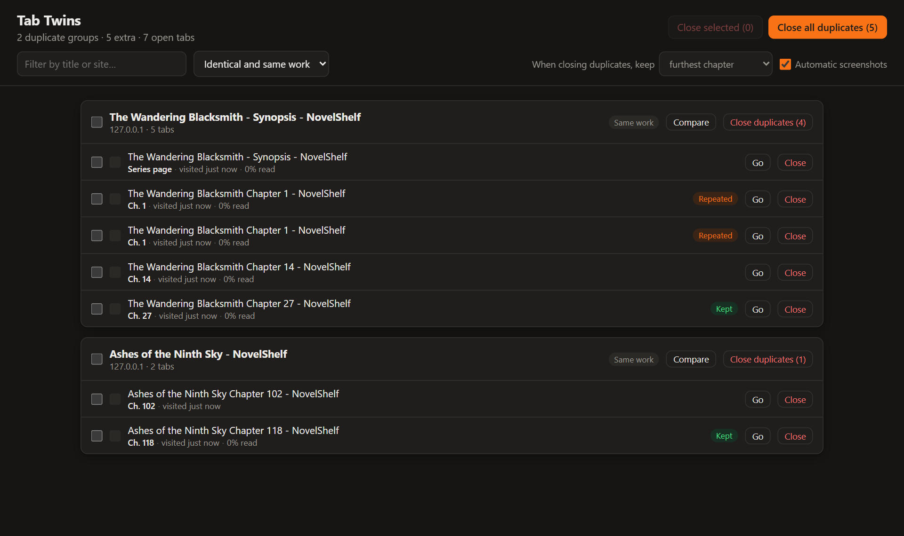
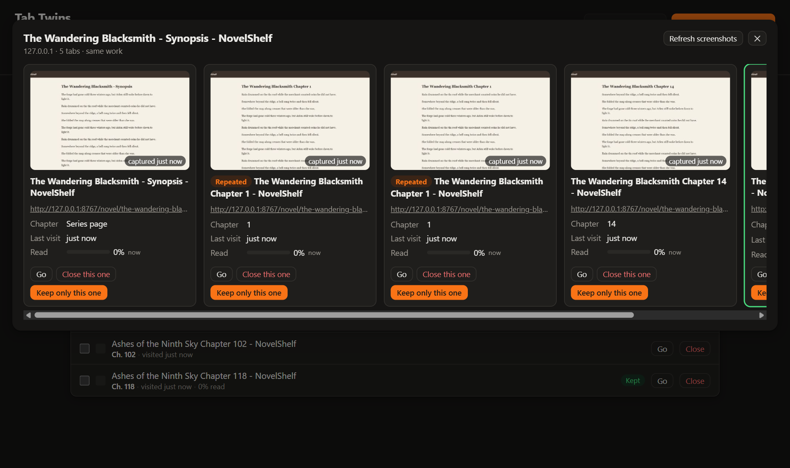
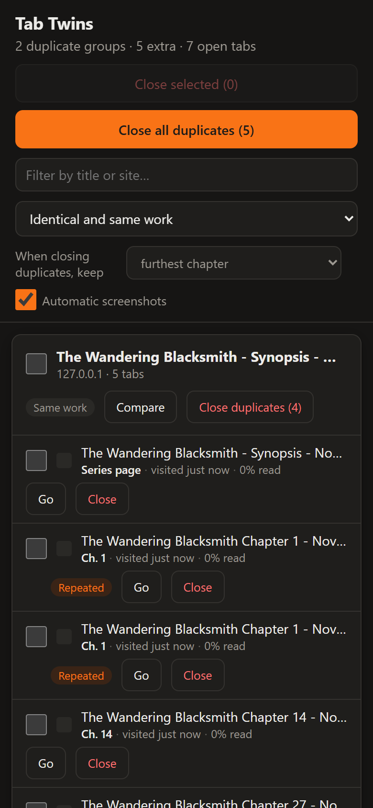

# Tab Twins

**Find duplicate tabs, compare them side by side, and decide which ones to close.**

Built for people who keep dozens of tabs open, like web novel readers who open a novel, leave it for later, find it again weeks later, and end up with the same story open three times at different chapters. Tab Twins spots those twins, shows you which one is furthest along, and lets you close the rest. Nothing is ever closed automatically.

[Español](README.es.md) · [Privacy](PRIVACY.md) · [Changelog](CHANGELOG.md)



## Features

- **Smart detection**
  - **Identical:** the same URL, ignoring `#fragments`, tracking parameters (`utm_*`, `fbclid`…), `www.` and `http`/`https`.
  - **Same work:** the same novel or series on the same site, even at different chapters (`chapter-5`, `Ch. 12`, `Capítulo 3`, `第88章`…), including its synopsis or series page.
- **Search all open tabs** from the toolbar popup, and see right away if the current tab has twins.
- **Compare side by side:** screenshot, chapter, last visit, how much of the page you've read, window and tab group.
- **Close exactly what you want:** one tab, the ones you select, the duplicates of one group, or every duplicate in the current filter. Filter by window and tab group.
- **Choose what to keep:** the furthest chapter, the most recently visited tab, or the one opened first. Pinned tabs are never closed in bulk.
- **Always reversible:** bulk closes ask for confirmation, and every close can be undone.
- **Badge** with the number of extra tabs.
- **English and Spanish**, following your browser's language.
- **Works on Firefox for Android**, with a touch-friendly layout.

| Compare | Firefox for Android |
|---|---|
|  |  |

## Download and install

Download the files from the [latest release](https://github.com/Aigen1111/tab-twins/releases/latest).

| Browser | File | How to install |
|---|---|---|
| **Chrome, Brave, Edge, Opera, Vivaldi** (desktop) | `tab-twins-<version>-chromium.zip` | [Load unpacked](#chrome-brave-edge-and-other-chromium-browsers) |
| **Firefox** (desktop, 140+) | `tab-twins-<version>-firefox.zip` | [Temporary add-on](#firefox-desktop), or from Firefox Add-ons once published |
| **Firefox for Android** (142+) | — | From Firefox Add-ons once published ([details](#firefox-for-android)) |
| Chrome and Brave for Android | — | Not possible: these browsers don't support extensions |

> Store listings (Chrome Web Store and Firefox Add-ons) are not available yet. Until then, use the files from the release.

### Chrome, Brave, Edge and other Chromium browsers

1. Download `tab-twins-<version>-chromium.zip` and unzip it into a folder you'll keep (the browser loads it from there).
2. Open `chrome://extensions` (in Brave, `brave://extensions`; in Edge, `edge://extensions`).
3. Turn on **Developer mode**.
4. Click **Load unpacked** and select the unzipped folder (the one that contains `manifest.json`).
5. Pin the Tab Twins icon to the toolbar.

To update, unzip the new version over the same folder and click the reload button on the extension's card.

### Firefox (desktop)

Firefox only installs extensions permanently if Mozilla has signed them. Until Tab Twins is on Firefox Add-ons:

1. Download `tab-twins-<version>-firefox.zip`.
2. Open `about:debugging#/runtime/this-firefox`.
3. Click **Load Temporary Add-on…** and select the zip file.

A temporary add-on is removed when Firefox closes.

### Firefox for Android

Firefox for Android installs extensions from Firefox Add-ons. Once Tab Twins is published there, open its page on your phone and tap **Add to Firefox**.

If you have a **signed** `.xpi` file, you can also install it from a file: **Settings › About Firefox**, tap the Firefox logo five times, go back to **Settings** and choose **Install extension from file**.

On Android there are no windows or tab groups, so those filters are hidden. Everything else works the same.

## How to use it

1. Click the Tab Twins icon. Type to search all your open tabs, or check the summary of duplicates.
2. Click **Review duplicates** to open the manager.
3. Click **Compare** on a group to see its tabs side by side. **Keep only this one** closes the rest of the group.
4. Or use **Close duplicates** on a group, or **Close all duplicates**. The tab marked **Kept** stays open, based on the rule you choose under **When closing duplicates, keep**.
5. Changed your mind? Click **Undo** in the notice that appears after closing.

Screenshots are taken when you visit a tab. For tabs you haven't visited since installing, use **Capture** or **Refresh screenshots** in the comparison: it briefly switches to each tab.

## Permissions and privacy

Tab Twins doesn't collect, send or share anything. Everything stays in your browser. See the full [privacy policy](PRIVACY.md).

| Permission | Why |
|---|---|
| `tabs`, `tabGroups` | Read the titles, URLs and groups of your open tabs to find duplicates |
| Access to all websites, `scripting` | Take screenshots of tabs and read how far you've scrolled |
| `storage`, `unlimitedStorage` | Keep those small screenshots and scroll positions locally |

Screenshots and scroll positions are deleted as soon as no open tab has that URL anymore. Automatic screenshots can be turned off in the manager.

## Known limitations

- Browsers can only capture the **visible** tab of each window, so tabs you haven't visited since installing have no screenshot until you capture them.
- Reading progress is unknown for tabs that were already open and asleep when you installed Tab Twins, until you reload them.
- "Same work" detection is based on URL and title patterns. Sites with unusual URLs may not be grouped. Please [open an issue](https://github.com/Aigen1111/tab-twins/issues) with an example URL.
- In Firefox, tabs with the same URL in different containers count as duplicates.

## Development

No dependencies and no build step: the repository folder is the extension. The scripts need Node.js 22.2 or later.

```sh
npm test            # unit tests (detection, translations, packaging)
npm run locales     # regenerate _locales/ from scripts/locales.mjs
npm run package     # build dist/tab-twins-<version>-chromium.zip and -firefox.zip
```

To try your changes, load the repository folder as an unpacked extension (Chromium) or select `manifest.json` in `about:debugging` (Firefox).

```
manifest.json         one manifest for every browser (the packages trim it per browser)
_locales/             generated translations (edit scripts/locales.mjs instead)
src/background.js     badge, screenshots and cleanup
src/content/scroll.js records how far you've scrolled
src/lib/grouping.js   duplicate detection (pure functions, unit-tested)
src/popup/            toolbar popup: search and summary
src/manager/          full-page manager: groups, compare, close and undo
scripts/              translations and packaging
```

### Translations

All interface text lives in [`scripts/locales.mjs`](scripts/locales.mjs). To add a language, add it to `LOCALES`, add one value per string, and run `npm run locales`. The tests check that every language uses the same placeholders.

### Releases

1. Update `version` in `manifest.json` and add the changes to `CHANGELOG.md`.
2. Create and push a tag that matches the version: `git tag v0.2.0 && git push origin v0.2.0`.
3. GitHub Actions runs the tests, builds both zips and publishes them in a new release.

## License

[MIT](LICENSE)
